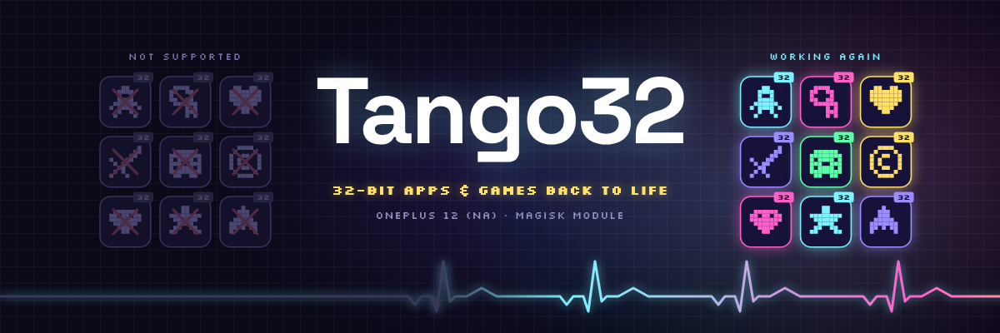

# Tango32 — 32-bit app support for the OnePlus 12 (NA, CPH2583)
<!-- Updated: 2026-11-19 12:15 ET (v1.2 wip: boot capture lastboot + start log, max debug logging, split logs zip) -->



https://github.com/user-attachments/assets/9ddbfc2e-237b-4448-b132-f2f76734520b

A Magisk module that turns on **Tango**, OnePlus's built-in 32→64-bit translator, on the North American OnePlus 12
(NA, model CPH2583). The Snapdragon 8 Gen 3 has no 32-bit CPU cores, so old 32-bit-only apps and games won't install
or run on its OxygenOS ROM. OnePlus ships Tango enabled only on the Chinese ColorOS ROM; Tango32 brings it over.

> First public working Tango port for the OnePlus 12 NA (CPH2583), as far as we know.

**Verified on OxygenOS 16.0.10.601 (EX01) only.** Read [Risks](#risks) before you install.

### ❤️ Support Tango32
Tango32 is free and open source, built over many late nights of reverse engineering.
If it brought an old favorite back to your phone, a small tip helps fund testing,
new firmware support and more phones.

[](https://ko-fi.com/iontrix)
[](https://github.com/sponsors/ionTrix)

Not required: bug reports, app reports and a ⭐ star help just as much.

## Contents
- What it does
- Requirements
- What's supported
- Risks
- Build
- Install
- Using it (Action)
- Known-working apps
- Online app patches
- Disable and rescue
- OxygenOS updates (OTA)
- Reporting a problem
- How it works
- Repo layout
- Credits
- Support the work
- License

<!-- §What it does -->
## What it does
- Starts a second, 32-bit app zygote that runs through the phone's own Tango kernel driver (`/dev/tango32`).
- Adds the 32-bit system libraries, taken from the public ColorOS CN firmware for the same phone.
- Bridges the gaps between the CN 32-bit runtime and the US framework (a small framework shim and a
  graphics parcel bridge), so apps get a working screen, touch and sound.
- With the module active, 32-bit APKs install normally from any file manager.
- Adds a Magisk **Action** for the old apps Android refuses to install (targetSdk < 24 on Android 15+,
  < 23 on Android 14): it lists them from the `Tango32` folder (top of your storage) and installs them.

The 64-bit system is not touched: the CN runtime lives only inside the 32-bit zygote's private mount namespace.

<!-- §Requirements -->
## Requirements
| Item | Need |
|---|---|
| Phone | OnePlus 12 **NA, model CPH2583** (CPH2581 community-tested) — no other model or region |
| Firmware | OxygenOS 16.0.10.601 (others: untested, build refuses by default) |
| Root | Magisk (tested v31.1), unlocked bootloader |
| Build machine | Linux or WSL2, x86-64, root, ~25 GB free disk, ~7.7 GB download |
| On the phone | Termux, or a PC with adb, to run `pull_fw.sh` (no root needed for that) |

<!-- §What's supported -->
## What's supported
| Supported | Not supported (for now) |
|---|---|
| OnePlus 12 **NA (CPH2583)** | Other OnePlus 12 regions (CN, India), other phones |
| CPH2581 16.0.10.601(EX01) · Magisk · **community-tested** (@arcinin1) | |
| The **latest verified** OxygenOS firmware (now 16.0.10.601) | Older firmware; newer firmware until it's tested |
| **Magisk** · **KernelSU / KernelSU Next** (v1.2, community testing) · APatch (untested) | Other root managers (Tango32 turns itself off if its SELinux rules can't be applied, see Build guards) |

New firmware is tested and added as it rolls out. Other phones and root managers may be added if there's enough
interest: say so in an issue. Reports from unsupported setups are welcome but may not get a fix.

<!-- §Risks -->
## Risks
- **No warranty.** This changes how your phone starts apps. It can crash apps, drain battery, or in the
  worst case stop the phone from booting until you disable the module. Use at your own risk.
- You need an unlocked bootloader and root already. Unlocking wipes the phone and may affect warranty.
- Keep a way back **before** installing: a copy of your stock `init_boot` image and know how to use
  `fastboot` (see [Disable and rescue](#disable-and-rescue)).
- Never take an OxygenOS update with the module enabled (see [OTA](#oxygenos-updates-ota)).
- Apps run translated: expect them to be slower than native, and some may not work at all.

<!-- §Build -->
## Build
No prebuilt module is published: it would contain OnePlus code. You build it yourself from the public CN
firmware plus framework files from **your own phone**.

**New to this? Follow the step-by-step guide: [docs/BUILD.md](docs/BUILD.md)** (Windows or Linux, no experience needed).

1. **Pull your phone's framework** with `pull_fw.sh`, either:
   - on the phone in Termux (`termux-setup-storage` once): `sh pull_fw.sh` → `Download/tango32_fw/fw/`
     (also `fw.zip` if you `pkg install zip`); or
   - on Linux/WSL with adb (USB debugging on): `sh pull_fw.sh` → `fw/` and `fw.zip` next to the script.
2. Copy `fw.zip` (or the `fw/` folder) next to `build.sh` and run, as root:
   ```
   bash build.sh            # PRUNE=0 bash build.sh = full unpruned module (216 MB vs 141 MB)
   ```
   Takes ~6 min plus the download (SHA-256 verified; a dropped download just needs a rerun).
   Output: `/root/re-work/module/tango32-<version>.zip`.
3. CN firmware sources: tried in order `CN_LOCAL` (your own copy: a folder with the 4 `.img` files or the 4
   `.7z` parts, or the path of the `.7z.001` part), `CN_MIRROR` (a folder URL with the 4 parts), then the
   list in `src/cn/mirrors.txt`. Every image must match the SHA-256 pinned in `src/cn/cn.sha256`, so any copy
   is safe. If all fail, the build prints exactly which files it needs.

### Build guards
| Where | Check |
|---|---|
| `build.sh` | fw must be from a CPH2583 or CPH2581 with a fingerprint; firmware must be 16.0.10.601 (`ALLOW_UNTESTED=1` to try others — unverified) |
| Install (`customize.sh`) | Model and **exact build fingerprint** must match the phone the fw came from; otherwise nothing is installed and nothing changes |
| Every boot (`post-fs-data.sh`) | Fingerprint must still match (e.g. after an OTA). Otherwise Tango32 sets nothing up, turns itself off in Magisk, hides its Action button, and its description reads *⛔ Disabled: phone firmware doesn't match the firmware Tango32 was built for.* |
| Every boot (`post-fs-data.sh`) | Every SELinux rule must apply, live, through the root manager's own tool: Magisk `magiskpolicy`, KernelSU `ksud sepolicy patch`, APatch `apd sepolicy patch` (the one used is logged in `tango32.log`). Otherwise the same: nothing set up, module off, Action hidden, description *⛔ Root manager not supported: SELinux rules failed (see tango32.log)*. The 32-bit zygote is never started half set up |

**Advanced:** to try another root manager anyway, `su -c touch /data/adb/modules/tango32/allow_any_root` and
reboot. Unsupported: with rules missing, the 32-bit zygote is known to crash-loop or freeze the phone (seen on
KernelSU before v1.2). Keep your rescue images ready.

<!-- §Install -->
## Install
1. Copy the zip to the phone. Magisk → Modules → **Install from storage** → pick the zip (KernelSU / APatch:
   install it from their Modules screen the same way).
2. Check the log shows `Build check OK: …`, then reboot. Wait ~30 s after unlocking.
3. Check it's running: `su -c getprop init.svc.zygote_tango` → `running`. Install creates the `Tango32`
   folder at the top of your storage (with a `README.txt`); after each boot a report is saved there as
   `logs/tango32_logs.zip`.

<!-- §Using it (Action) -->
## Using it (Action)
**Most apps:** just tap the APK in your file manager, as usual. With Tango32 active, 32-bit apps install normally.

**Old apps:** if the file manager says *"App not installed as app isn't compatible with your phone"*, the app
targets an Android version too old for Android to accept (below Android 7 / API 24 on Android 15+). Put it in
the `Tango32` folder at the top of your storage (`sdcard/Tango32`, subfolders are fine), then Magisk → Modules →
Tango32 → **Action**. Only these old APKs are listed. Only this folder is scanned; if it's deleted or moved,
it is recreated (empty) at the next boot or Action run.

| Key | Does |
|---|---|
| Press Vol+ / Vol− | Scroll the list |
| **Hold** Vol+ or Vol− 1 s | Install the selected APK (also updates an installed one) |
| **Hold** Vol+ **and** Vol− 5 s | Save bug report logs (see [Reporting a problem](#reporting-a-problem)) |
| Magisk's back arrow | Leave (5 min idle = timeout) |

Each entry: `1/2 ✅ App v1.3 [32bit]` + its file. `[32bit]` = 32-bit only, `[64bit]` = 64-bit or no native code, `[?bit]` = can't read a damaged or corrupt APK (download it again).

| Mark | Means | Hold does |
|---|---|---|
| ⬛ | Available (not installed) | Install |
| ✅ | Installed, same version | Reinstall |
| 🔼 | Update (APK is newer) | Update |
| 🔽 | Downgrade (installed is newer) | Asks first; app data is kept, but an older version may not read it |
| 🔀 | Mismatched signatures (different developer key) | Asks first; uninstalls the installed app (**its data is deleted**), then installs |
| ✅+🩹 | Installed and patched | Reinstall (patch re-applied) |

**Pre-flight check:** Action also reads each 32-bit APK's native libraries and compares them with the phone
(results cached, so only new APKs take a moment). Extra lines under an entry:
- `🩹 Fix available: …` — an app patch fits this app; it's applied right after the install.
- `🩹 Fix to try if it crashes: …` — a patch that fixed the same kind of crash in a similar app.
- `⚠️ Missing Android functions: N (lib: name)` — the app uses Android functions this phone doesn't have; it
  will likely crash on start. Please send an App report or a bug report with logs.

**Quick test:** after every install, the app opens (after a 5 second pause) and must keep running for 5 seconds;
then Magisk comes back with `Quick test: Passed` or `Quick test: Failed`. The touchscreen is locked while the app
is open, so a stray tap can't change the result; it unlocks as soon as the test ends (40 seconds at most). Old apps skip Android's permission review screen for the test;
the review comes back afterwards, and a fresh install gets its app data cleared, so your first real start is
clean. If the test fails and a matching fix exists, Action applies it (`Quick test: Failed, trying auto-patch . . .`)
and tests again; a fix that doesn't help is removed. Every install and test goes to `Tango32/logs/install.log`,
with crash details when a test fails.

Questions are answered by holding a key 1 s: Vol+ = Yes, Vol− = No.

Installing from adb works too: `adb install --bypass-low-target-sdk-block app.apk`.

<!-- §Known-working apps -->
## Known-working apps
See **[APPS.md](APPS.md)** for every app tested so far (status, version, install route), and for **app patches**:
small per-app fixes (e.g. Galcon Fusion's GL crash) that Action applies automatically after installing the app.
Nothing from any app is shipped.

Tested something? Open an issue (template: **App report**) with the result and it'll go in the list.

<!-- §Online app patches -->
## Online app patches
New app patches are published here on GitHub, so a fix for another game can reach your phone without a new
module build. Every time you open **Action** it asks: *Check GitHub for new app patches?* (hold Vol+ = Yes,
Vol− = No; No skips it this time only). Nothing is checked at boot.

Yes checks (at most ~10 s; `App patches up to date` / `New patch: …`). New patches are kept for Action's pre-flight
check, and apps that already use a patch get the new copy right away.
- **What is sent:** nothing about you or your apps. The phone downloads the public patch list (`index.json` from
  the Release [`patches`](https://github.com/ionTrix/Tango32/releases/tag/patches)) and matches it to apps itself.
- **Safety:** the list is signed (ECDSA P-256) by this repo's CI; the module has the public key built in and
  rejects any list that isn't signed with it, is older than the last one it accepted, or any file whose SHA-256
  doesn't match. Downloads use the phone's own TLS checks.
- **Where:** `/data/adb/tango32/` (downloaded patches, which app got which patch, pre-flight cache). Kept across
  module updates, removed on uninstall.

| Do | Termux |
|---|---|
| Status, last check, downloaded patches | `su -c sh /data/adb/modules/tango32/patches.sh` |
| Check now | `su -c sh /data/adb/modules/tango32/patches.sh check` |
| Undo a patch | `su -c sh /data/adb/modules/tango32/patches/apply.sh <package> undo` |

<!-- §Disable and rescue -->
## Disable and rescue
| Situation | Do |
|---|---|
| Module misbehaves | Magisk (or KernelSU / APatch) → Modules → toggle Tango32 off → reboot. Or `su -c touch /data/adb/modules/tango32/disable` → reboot |
| Only the private namespace is suspect | `su -c touch /data/adb/modules/tango32/ns_off` → reboot (v1.1: the 32-bit zygote then doesn't start at all; for testing only) |
| Touchscreen stays locked after a quick test | Wait 40 seconds (the lock's limit), or Termux `su -c pkill -f touchgrab` |
| Graphics bridge is suspect | `su -c touch /dev/tango_gui_off`, then `su -c 'stop zygote_tango; start zygote_tango'` (until reboot) |
| Phone won't boot | Boot to fastboot (Power + Vol−) and flash your stock `init_boot`: `fastboot flash init_boot init_boot_stock.img`. Phone boots unrooted; re-root with your patched image (Magisk, KernelSU or APatch), then remove the module |
| Uninstall | Magisk → Modules → Remove → reboot. Removes `README.txt` and the `logs` folder's files from `sdcard/Tango32` (your APKs stay) |
| Module shows ⛔ Root manager not supported | Your root manager's SELinux tool rejected a rule (or none was found). `tango32.log` names the tool and the failed rules. Please open an issue with the logs: Termux `su -c sh /data/adb/modules/tango32/logs.sh` |
| Module shows ⛔ Disabled | The phone's firmware changed since the build (OTA). Rebuild for the new firmware (see below). The Action button is hidden meanwhile; the boot report is still saved to `Tango32/logs/tango32_logs.zip` at every boot, or save full logs from Termux: `su -c sh /data/adb/modules/tango32/logs.sh` |

Don't: disable `vbmeta` verification, or format data from recovery, to "fix" a boot problem.

<!-- §OxygenOS updates (OTA) -->
## OxygenOS updates (OTA)
The module is built for **one exact firmware**. After an update it will no longer match.
1. **Before** updating: toggle Tango32 off in Magisk, then update the usual Magisk way (Uninstall → Restore
   Images → OTA → Install to Inactive Slot).
2. After updating: re-run `pull_fw.sh`, rebuild (`ALLOW_UNTESTED=1` until the new firmware is verified),
   remove the old module, install the new zip.
3. Forgot step 1? At the first boot on the new firmware Tango32 notices the mismatch, sets nothing up and turns
   itself off (⛔ in its description). Turning it back on does nothing until you install a matching build.
4. If the new firmware breaks something, please open an issue with logcat — framework changes may need new
   shim or bridge work.

<!-- §Reporting a problem -->
## Reporting a problem
Use the issue templates. They ask for model, `ro.build.display.id`, module version, app + version, and logs.
Reproduce the problem, then open Magisk → Tango32 → **Action** and hold **Vol+ and Vol− for 5 s**
(or run `su -c sh /data/adb/modules/tango32/logs.sh`). It saves `Tango32/logs/tango32_logs.zip`; attach that file. If it's too big for one GitHub upload (mostly with max debug logging), it's split into `tango32_logs.zip`, `tango32_logs_2.zip` …, each under GitHub's 25 MB limit: attach all parts. Each file starts with a numbered
Contents list; search for `§3` (etc.) to jump to a section.

| File | Has |
|---|---|
| `1_summary.txt` | Versions, app patches, pre-flight results, known Tango32 error lines, the newest crash summaries |
| `2_boot_report.txt` | Boot report (firmware check, zygote, namespace, app patches) |
| `3_logcat.txt` | Crash lines, the last 5 minutes of log (at most 150 lines per log tag), and every Tango-related line — not the full log |
| `4_install.log` | Every Action install and quick test, with crash details for failed tests (also at `Tango32/logs/install.log`) |
| `5_boot1_*.txt`, `5_boot2_*.txt` | Only for the first 2 boots after an install or update (v1.2): boot reason, "last alive" time, full logcat of the first 5 minutes (`logcat_start` = the first 2 minutes, kept whole), kernel log, and `lastboot` (the previous boot's end, if the kernel kept it). Helps when the phone reboots by itself. Full logcat: may contain personal data |
| `5_dboot0..2_*.txt`, `6_debug_*.txt` | Max debug logging only (below): the 3 newest boots (15 minutes each), plus the full logcat, kernel log, system properties, processes and full crash reports |

Logs may contain personal data (account names, other apps), review first.

**Max debug logging (for testers):** create an empty file named `debug.txt` in `sdcard/Tango32` (any file manager)
and reboot. Every boot is then logged in full, and the bug report zip gets everything above. After each boot,
`debug.txt` is rewritten with a list of what was saved and how to send it. Save the logs (Action, hold Vol+ and
Vol− 5 s) after reproducing the problem, at least 15 minutes after a boot for the full capture. To turn it off,
delete `debug.txt` and reboot. Logs get large (tens of MB on the phone) and include the full logcat.

<!-- §How it works -->
## How it works
| Part | What |
|---|---|
| 32-bit libs (`system/lib`, `vendor/lib`, `product/lib`, APEX `lib/`) | From ColorOS PJD110 16.0.3.500 (CN), pruned to what app processes can reach |
| `app_process32` wrapper | Starts the 32-bit zygote in a private mount namespace with the CN ART/i18n/conscrypt APEXes; the 64-bit system never sees them |
| `tango-shim.jar` | Patched US framework classes so the CN native runtime and the US Java framework agree on method signatures |
| `libtango_gui.so` | Parcel bridge: adds fields the OxygenOS SurfaceFlinger expects but CN 32-bit `libgui` doesn't write (fixes black screen / dead touch) |
| `post-fs-data.sh` | SELinux rules, Tango props, binfmt registration, lib layering |

<!-- §Repo layout -->
## Repo layout
| Path | What |
|---|---|
| `build.sh` | Build: guard, CN firmware download, shim/bridge/helper builds, module assembly + zip. Version = `VER` |
| `pull_fw.sh` | Collects your phone's boot framework jars + build info (Termux or adb, no root) |
| `src/shim/` | Framework shim edits (`shim_edit.py`), `TangoFdFix.java` + compile stubs |
| `src/bridge/` | `libtango_gui.so` parcel-format bridge (`tango_gui.c`) |
| `src/apkinfo/` | `apkinfo.jar`: APK info for the Action, log zipper for `logs.sh`, online patch fetch + signature check (`Patches.java`) |
| `src/module/` | Module scripts: `customize.sh`, `post-fs-data.sh`, `service.sh`, `action.sh`, `logs.sh`, `tango32_dir.sh`, zygote wrapper, … |
| `src/cn/` | CN firmware: pinned image SHA-256 (`cn.sha256`) + download sources (`mirrors.txt`) |
| `src/patches/` | App patch families (one folder each: `patch.prop` + wrapper source), `apply.sh`, public key for online patches (`patches_pub.pem`) |
| `src/tools/` | Build helpers: lib prune, SELinux contexts, jar alignment, ART report |
| `tools/` | Repo helpers: patch build + index (`build_patches.sh`, `patch_index.py`, used by CI), social preview, release notes, CN cache, Tango32 Test app |
| `.github/workflows/patches.yml` | CI: builds, signs and publishes the online app patches |
| `docs/` | `BUILD.md` step-by-step build guide, banner + social preview |
| `CHANGELOG.md` | Version history |

<!-- §Credits -->
## Credits
- **OnePlus / OPPO** — the Tango translator itself. This project only turns it on.
- [spike0en/oneplus_archive](https://github.com/spike0en/oneplus_archive) — CN firmware archive.
- [Magisk](https://github.com/topjohnwu/Magisk) by topjohnwu.
- [smali/baksmali](https://github.com/google/smali) and [R8](https://r8.googlesource.com/r8) for the framework shim.
- Porting and reverse engineering: ionTrix, with Claude (Anthropic).
- Thanks: @arcinin1 — CPH2581 testing + KernelSU logs.

<!-- §Support the work -->
## Support the work
If Tango32 brought an old favorite back to your phone, a tip for the porting work is appreciated:
**[ko-fi.com/iontrix](https://ko-fi.com/iontrix)** (no account needed: PayPal, card, Apple/Google Pay) or
**[GitHub Sponsors](https://github.com/sponsors/ionTrix)** (one-time or monthly).
Not required — bug reports and app reports help just as much.

<!-- §License -->
## License
Tango32's own code (everything in this repo) is licensed under the **GNU GPL v3.0** — see [LICENSE](LICENSE).
The module you build also contains OnePlus, Qualcomm and Android code taken from firmware; that code is not
covered by this license and stays with its owners. Don't redistribute built module zips.

Not affiliated with OnePlus, OPPO or Google. OnePlus and OxygenOS are trademarks of their owners.
